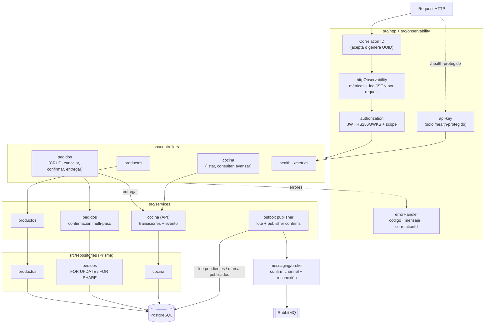
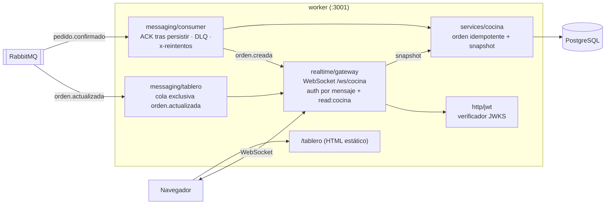

# C4 - Nivel 3: Component

## Contenedor `api`

### Flujo multi-paso: confirmar pedido

1. `pedidos` controller recibe `POST /pedidos/{id}/confirmar`; `authorization`
   exige `confirm:pedidos`.
2. `pedidos` service, **en una transacción**:
   - bloquea el pedido (`SELECT … FOR UPDATE`) y exige estado `pendiente`;
   - exige al menos un ítem y bloquea sus productos (`FOR SHARE`), que deben
     existir y estar disponibles;
   - calcula el total con los **precios capturados** en los ítems (Decimal);
   - guarda estado `confirmado`, total y `confirmadoEn`;
   - inserta `pedido.confirmado` en `outbox` con el correlation ID del request.
3. Cualquier rechazo (`404`/`409`) revierte todo. Tras el commit se despierta al
   publicador del outbox, que publica con confirmación de RabbitMQ y recién
   entonces marca `publicado_en`.
4. El worker consume el evento y crea la `OrdenCocina` (ver abajo).

## Contenedor `worker`

Contratos: eventos en [eventos.md](../eventos.md) y WebSocket en
[websocket.md](../websocket.md).

Diagrama original de la Entrega 1 (solo API, con publicación directa del
evento): [imgs/component.png](imgs/component.png).
