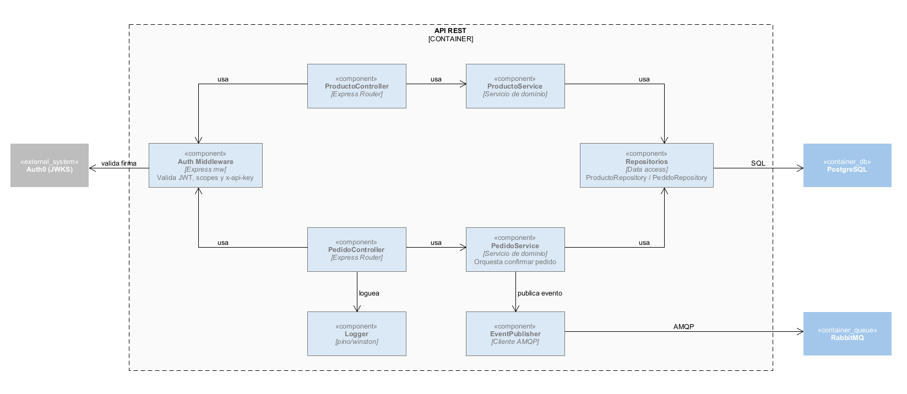

# C4 - Nivel 3: Component

Vista interna del contenedor **API REST** (el contenedor más relevante para el TPI).

## Implementado en E2-01

`src/api.js` y `src/worker.js` arrancan los procesos. Para `/health`,
`src/controllers/health.js` atiende HTTP, `src/services/health.js` combina el estado
de dependencias y `src/repositories/database.js` ejecuta `SELECT 1` (desde E2-02,
mediante Prisma y su adaptador PostgreSQL). `src/messaging/broker.js` mantiene y
recupera la conexión y el canal AMQP. El esquema, migraciones y seed están en
`prisma/`. Los componentes de pedidos de la imagen y el flujo
siguiente siguen siendo el diseño objetivo.

## Implementado en E2-03

Los controllers de `productos` y `pedidos` publican los CRUD y cancelación;
los services validan entradas y calculan importes con Decimal; los repositories
usan Prisma. Editar/eliminar/cancelar bloquea la fila del pedido dentro de una
transacción y exige estado `pendiente`. El middleware JWT/JWKS aplica scopes;
la configuración del tenant real se completa en E2-04. Las respuestas de error
incluyen correlation ID. Confirmación y publicación en outbox siguen en E2-05.

## Flujo multi-paso (confirmar pedido)

1. `PedidoController` recibe `POST /pedidos/{id}/confirmar` con Bearer JWT (`scope: confirm:pedidos`).
2. `authMw` valida token y scope.
3. `PedidoService.confirmar(id)`:
   - Verifica que el pedido exista y no esté ya confirmado.
   - Valida que cada producto referenciado exista y esté disponible.
   - Calcula el total sumando `cantidad * precioUnitario`.
   - Cambia el estado del pedido a `confirmado`.
   - Persiste los cambios vía `PedidoRepository`.
   - Publica el evento `pedido.confirmado` vía `EventPublisher`.
4. El Worker de Cocina (fuera de este contenedor) consume el evento y genera la `OrdenCocina`.
