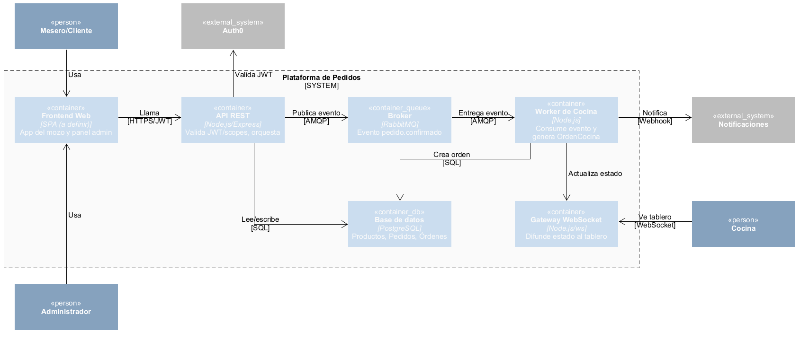

# C4 - Nivel 2: Container

Vista de los "contenedores" (servicios desplegables) que componen la plataforma.

## Notas

- El "Worker de Cocina" y el "Gateway WebSocket" compartirán el proceso del servicio `worker`, expuesto en `3001`. E2-01 incorpora el proceso y su `/health`; el gateway y el tablero corresponden a E2-07. La imagen representa el diseño objetivo.
- El endpoint protegido con `x-api-key` (requisito de la consigna) vive dentro del mismo contenedor API, como una ruta aparte de ejemplo — no hace falta un contenedor nuevo.
- La API propia escucha en `3000`. Ambos procesos comprueban PostgreSQL (`db:5432`) y mantienen una conexión/canal AMQP con RabbitMQ (`broker:5672`). Esto todavía no implementa el flujo de negocio del diagrama.
- Desde E2-02, `migrate` aplica las migraciones SQL y termina antes de iniciar API/worker. Es una tarea de arranque que usa el Dockerfile de la API, sin puerto propio. El seed se ejecuta manualmente.
