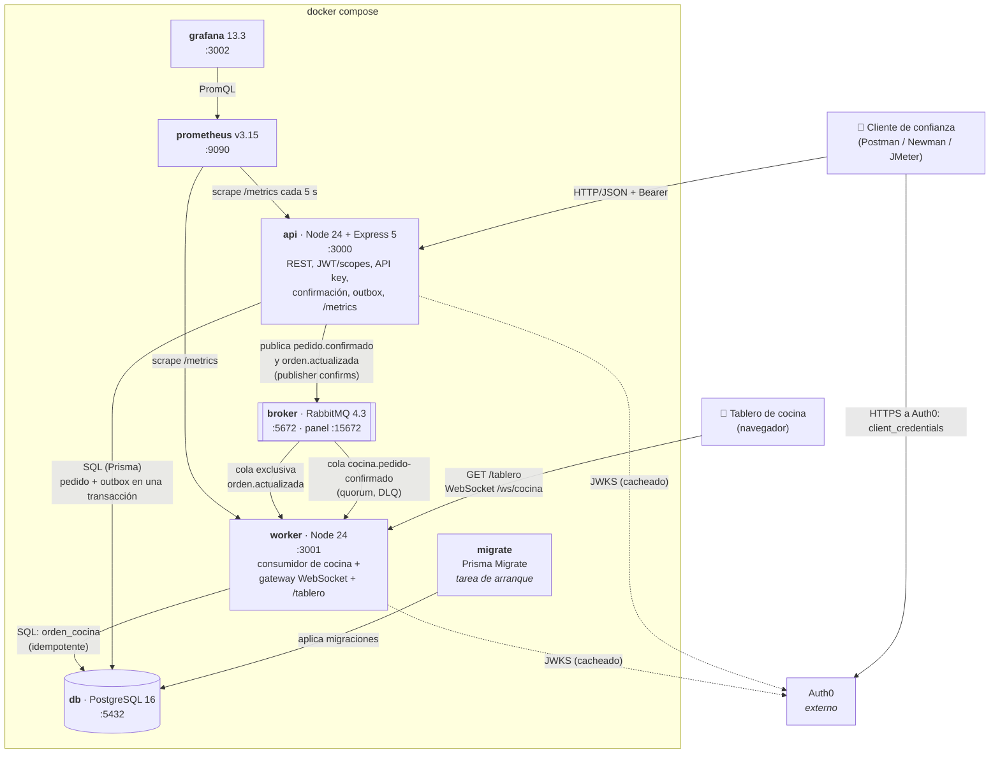

# C4 - Nivel 2: Container

Procesos desplegables definidos en [`docker-compose.yml`](../../docker-compose.yml).

## Notas

- **worker = consumidor + gateway WebSocket en un mismo proceso** (puerto 3001).
  `orden.creada` se emite en memoria después de persistir la orden.
  `orden.actualizada` la genera la API (otro proceso) y llega por RabbitMQ: los
  procesos no comparten memoria.
- **Consistencia:** la confirmación y el evento se guardan juntos en PostgreSQL
  (outbox). La orden de cocina se crea después, de forma eventual
  ([ADR 005](../adr/005-outbox-consistencia.md)).
- El endpoint con `x-api-key` (`GET /health-protegido`) es una ruta del
  contenedor `api`, no un contenedor aparte.
- `migrate` usa la imagen de la API, termina con código 0 y recién entonces
  arrancan `api` y `worker`. El seed se ejecuta manualmente (`npm run db:seed`).
- Volúmenes persistentes: `db_data`, `broker_data` (hostname fijo `broker`),
  `prometheus_data` y `grafana_data`.
- `jmeter` (perfil `carga`) solo se usa para la prueba de carga y no arranca con
  `docker compose up`.

Diagrama original de la Entrega 1: [imgs/container.png](imgs/container.png).
