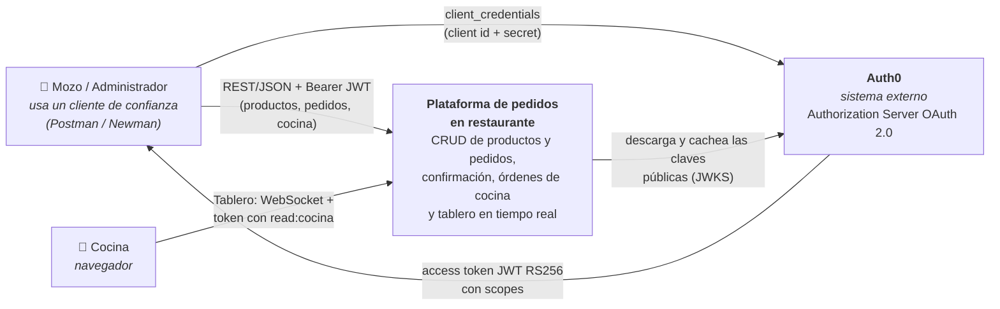

# C4 - Nivel 1: Context

Quién usa el sistema y con qué sistemas externos interactúa (implementación de la Entrega 2).

## Notas

- El sistema es una caja única en este nivel; el detalle de procesos está en
  [container.md](container.md).
- **Auth0 emite los tokens; no valida cada request.** La API y el gateway
  WebSocket validan el JWT **localmente** (firma RS256, issuer, audience,
  expiración y scopes) con las claves públicas del JWKS de Auth0, que se
  descargan y se cachean.
- Los mozos y administradores operan con un cliente M2M de confianza (Postman en
  la demo). Un frontend completo no forma parte del alcance mínimo.
- El tablero de cocina no contiene secretos: se pega un access token con
  `read:cocina`, obtenido desde ese cliente de confianza.
- **Cambio respecto de la Entrega 1:** se quitó el servicio externo de
  notificaciones por webhook. La consigna exige una sola integración adicional y
  se eligió WebSocket ([ADR 001](../adr/001-estilo-api.md)).

Diagrama original de la Entrega 1 (incluía el webhook): [imgs/context.png](imgs/context.png).
