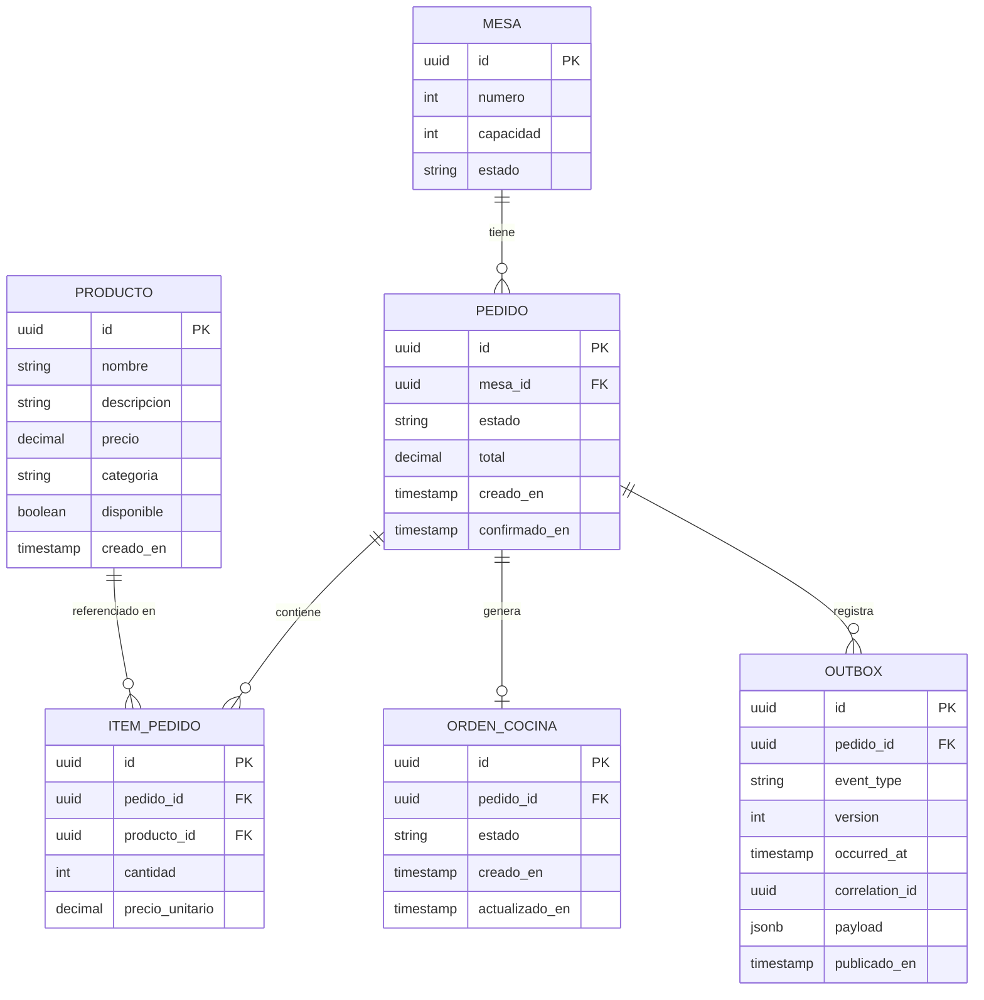

# Modelo de datos

Motor: **PostgreSQL**; acceso a datos con **Prisma ORM** y migraciones con **Prisma Migrate** (ver ADR 002). Esquema implementado en `prisma/schema.prisma`; migración inicial en `prisma/migrations/`.

Convención confirmada: JSON en `camelCase` y tablas/columnas SQL en `snake_case`,
con mapeo explícito en Prisma. Por ejemplo, `precioUnitario` en JSON corresponde
a `precio_unitario` en SQL. Los nombres de entidades del diagrama son conceptuales.

## Estados

**Pedido:** `pendiente` -> `confirmado` -> `en_preparacion` -> `listo` -> `entregado`. La cancelación se permite únicamente mediante `pendiente` -> `cancelado`.

**OrdenCocina:** `recibida` -> `en_preparacion` -> `lista`.

**Mesa:** `libre` u `ocupada`. Los tres conjuntos de estados son enums de PostgreSQL.

## Integridad y borrado

- Tablas físicas: `producto`, `mesa`, `pedido`, `item_pedido`, `orden_cocina` y `outbox`.
- UUID como PK/FK, generados por PostgreSQL; `Mesa.numero` es único y positivo.
- Cantidad y capacidad positivas; importes no negativos y sin `NaN`. Precios y
  precios unitarios usan `NUMERIC(12,2)`; total usa `NUMERIC(14,2)`. No usar floats
  para calcular importes en los servicios posteriores.
- Fechas con zona horaria (`TIMESTAMPTZ(3)`). Prisma actualiza `actualizadoEn` al
  modificar una orden; no se agregó un trigger para cambios hechos con SQL directo.
- Un pedido puede tener cero o una orden. `orden_cocina.pedido_id` es único.
- Rechazar el borrado de productos referenciados por ítems (`ON DELETE RESTRICT`);
  el precio del catálogo puede cambiar sin alterar `item_pedido.precio_unitario`.
  El CRUD de E2-03 deberá traducir ese conflicto a HTTP `409`.
- Borrar un pedido elimina sus ítems (`CASCADE`), pero una orden o evento outbox
  asociado impide borrar el pedido (`RESTRICT`). No se borran mesas con pedidos.
- Las FK tienen índices; el outbox tiene además índice por fecha de publicación
  y fecha del evento para buscar pendientes (`publicado_en IS NULL`). Su `id`
  será el `eventId` del mensaje; `correlation_id` es UUID, `version` positiva y
  `payload` un objeto JSON. El publicador se implementa en E2-05/E2-06.

## Reglas de validación relevantes

- Un pedido no puede confirmarse sin al menos un ítem (`pedido sin ítems`).
- Un pedido ya `confirmado` no puede volver a confirmarse (`pedido ya confirmado`).
- Cada `producto_id` referenciado en un ítem debe existir y estar `disponible` (`producto inexistente`).
- Transiciones de estado fuera de la máquina de estados definida arriba se rechazan (`estado inválido`).
- Editar, eliminar o cancelar requiere estado `pendiente`; en otro estado se responde `409`. Cancelar conserva el pedido con estado `cancelado`.

Las restricciones SQL garantizan tipos, estados permitidos, relaciones y valores
válidos. Las transiciones entre estados, disponibilidad de productos, captura de
precios y al menos un ítem al confirmar se validarán en los servicios de negocio;
no se presentan como lógica ya implementada en E2-02.

## Migraciones y seed

- Prisma ORM y Prisma Migrate `7.10.1`; esquema y SQL versionados. Los `CHECK` se
  agregan al SQL de la migración porque Prisma no los expresa en su esquema.
- El seed usa Prisma y una transacción: cuatro productos y tres mesas con IDs
  fijos. Repetirlo conserva cambios y no duplica registros. No crea pedidos ni
  órdenes que simulen haber recorrido el flujo asincrónico.
- Comandos y reinicialización: [README](../README.md#base-de-datos-migraciones-y-datos-de-demo).
