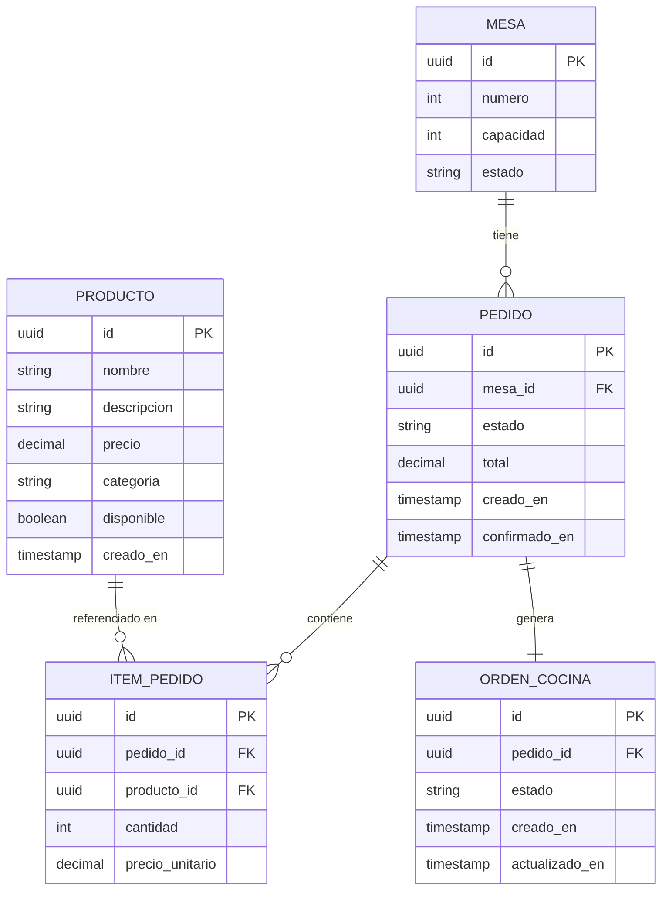

# Modelo de datos

Motor: **PostgreSQL**; acceso a datos con **Prisma ORM** y migraciones con **Prisma Migrate** (ver ADR 002). Decisión de E2; implementación pendiente.

Convención confirmada: JSON en `camelCase` y tablas/columnas SQL en `snake_case`,
con mapeo explícito en Prisma. Por ejemplo, `precioUnitario` en JSON corresponde
a `precio_unitario` en SQL. Los nombres de entidades del diagrama son conceptuales.

## Estados

**Pedido:** `pendiente` -> `confirmado` -> `en_preparacion` -> `listo` -> `entregado`. La cancelación se permite únicamente mediante `pendiente` -> `cancelado`.

**OrdenCocina:** `recibida` -> `en_preparacion` -> `lista`.

## Reglas de validación relevantes

- Un pedido no puede confirmarse sin al menos un ítem (`pedido sin ítems`).
- Un pedido ya `confirmado` no puede volver a confirmarse (`pedido ya confirmado`).
- Cada `producto_id` referenciado en un ítem debe existir y estar `disponible` (`producto inexistente`).
- Transiciones de estado fuera de la máquina de estados definida arriba se rechazan (`estado inválido`).
- Editar, eliminar o cancelar requiere estado `pendiente`; en otro estado se responde `409`. Cancelar conserva el pedido con estado `cancelado`.

## Migraciones y seed

- Usar Prisma ORM y Prisma Migrate `7.10.1`; versionar el esquema y las migraciones SQL generadas. El seed usa Prisma. Todavía no existen migraciones ni seed ejecutables.
- El seed inicial debe cargar: 3-5 productos de ejemplo, 2-3 mesas, y opcionalmente un pedido ya confirmado para poder mostrar el flujo de consulta sin tener que crear todo en la demo.
